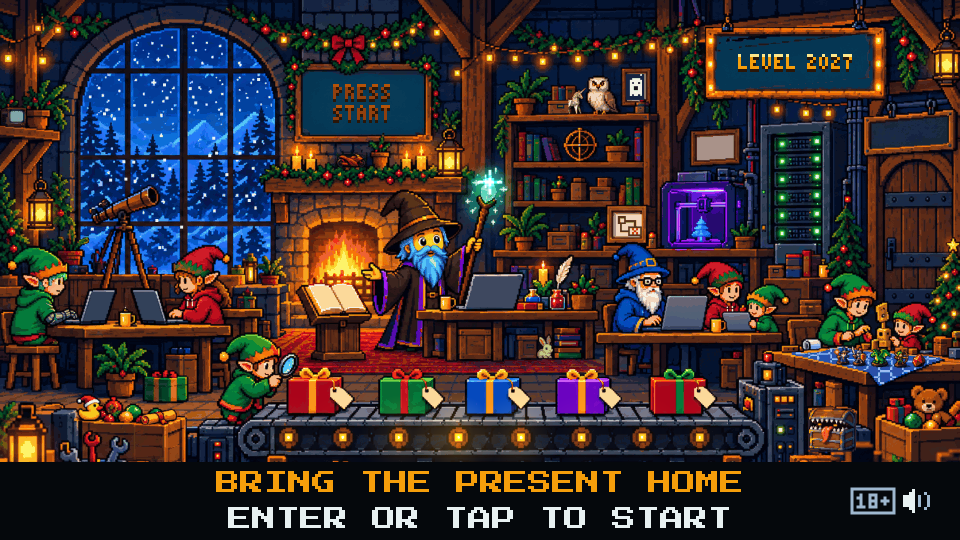
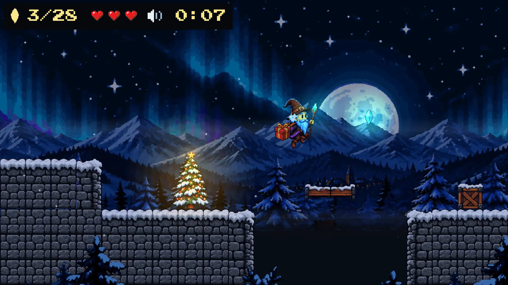

# Agentic Game Factory



You know this workshop from the hackers&wizards Christmas picture: here you walk through the door
and build a small game of your own, together with Claude Code or Codex. The game is the occasion.
What you practise is agentic engineering: plan first, build in small steps and let the agent check
its own work.

| You want                                 | Go to                                                                                                         |
| ---------------------------------------- | ------------------------------------------------------------------------------------------------------------- |
| to play the example right now            | [Play in the browser](https://hackersandwizards.github.io/agentic-game-factory/examples/present/), no install |
| to build your own game                   | [Build](#build), which assumes no terminal experience                                                         |
| to publish and show your game            | [Share](#share)                                                                                               |
| a trailer for your game                  | [Make your own video](#make-your-own-video)                                                                   |
| to know what runs on a commit and a push | [Check commands](docs/checks.md)                                                                              |
| to read the rules for your agent         | [CLAUDE.md](CLAUDE.md), its [rules](.claude/rules/) and [skills](.claude/skills/)                             |

[](docs/gameplay.mp4)

## Build

You need:

- [Claude Code](https://docs.anthropic.com/en/docs/claude-code) or
  [Codex](https://github.com/openai/codex). Each needs a paid plan or an API account.
- [Git](https://git-scm.com), [Bun](https://bun.sh) 1.4.5 or newer and [Node.js](https://nodejs.org)
  22 (22.22.2 or newer) or 24 (24.15.0 or newer).
- A free account on [github.com](https://github.com).

Never used a terminal? It is a window you type commands into. On a Mac, open "Terminal" via
Spotlight search; on Windows, "Git Bash" from the Start menu. Paste the commands below one line at a
time and press Enter after each.

First make your own copy: "Fork" at the top right on GitHub. Then clone your copy, so your game ends
up in your own repository. Write your GitHub user name in place of `<your-name>`. On Windows, turn on
Developer Mode first (Windows Settings, "For developers") and write
`git clone -c core.symlinks=true` in place of `git clone`: without both, Git checks out the link
`.agents/skills` as a text file and Codex finds no skills.

```sh
git clone https://github.com/<your-name>/agentic-game-factory.git my-game
cd my-game
bun install
bun run dev
```

`bun run dev` keeps running and takes over that window. Open `http://localhost:5173` in your
browser, Google Chrome is the recommended one: it lists the games, `/starter/` shows the starter your
game begins as, a square, and `http://localhost:5173/examples/present/` the example to play, "Bring
the present home". Open a second terminal, go to your folder with `cd my-game` and start your agent
with `claude` or `codex`.

On first start your agent asks whether it may use the `chrome-devtools` server: that is how it
plays your game itself, in a browser you do not see. Codex asks instead whether you trust the
folder: say yes. The folder sets the model for both agents: if yours reports that the model is
unavailable on your plan, type `/model` and pick one. From there three skills take you to your game.
In Codex, write "Start the game-wizard skill" instead of `/game-wizard`.

- `/game-wizard` finds a game idea with you that fits the evenings you have, and starts it in
  `examples/<game-name>/` with its plan, `GAME.md`. It researches on the web for that, and your agent asks you to allow the access.
- `/quest` builds it one quest at a time, each practising one habit such as plan mode or test first.
- `/game-review` has a fresh agent who saw none of the building play and rate it, until it says "ship".

`bun run check` checks files, links and dependencies, runs every test, builds the game and plays it
in the browser. Allow a few minutes; your agent runs it before each commit. `bun install` also set up
Git hooks that check every commit and push on your machine: the [check commands](docs/checks.md)
list what each runs.

## Share

In your copy on GitHub, allow workflows on the Actions tab once and set Settings, Pages, Source to
"GitHub Actions". From then on every push to `main` builds your game and publishes it at
`https://<your-name>.github.io/agentic-game-factory/examples/<game-name>/`. Your agent keeps your game on one branch with
one pull request against this repository: merge that branch into your `main` to publish. Or run
`bun run build`, which puts your game in `dist/`, and upload `dist/` as a ZIP to itch.io as an HTML5
game.

Show your game online with #AgenticGameFactory, tag us or send it to us through
[hackersandwizards.dev](https://hackersandwizards.dev). We show the games. Entries are open until
31 December 2026; on 1 January 2027 we pick the three best, and each wins a prize.

## Make your own video

`/studio` (in Codex: "Start the studio skill") turns your game into a 26-second trailer, and on
request makes a workshop picture like ours with a greeting video to go with it. The studio lives in
`studio/` with its own `package.json`, so your game stays untouched. It also needs ffmpeg, and cwebp
to rebuild the game art.

A gift from [hackers&wizards](https://hackersandwizards.dev). MIT licence, see [LICENSE](LICENSE)
and [CREDITS.md](CREDITS.md). To contribute, read [CONTRIBUTING.md](CONTRIBUTING.md). To report a
vulnerability, read [SECURITY.md](SECURITY.md).
